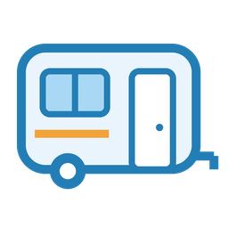

# Adria MACH for Home Assistant

Unofficial integration for monitoring and controlling your Adria vehicle through the MACH cloud service. Provides measurements, lights, heating and other controls supported by your vehicle.

Requires **Home Assistant 2026.11.0 or newer** and a MACH account with an assigned vehicle.

## Installation

1. Open **Settings → Marketplace → Add from link**. Connect your GitHub account if prompted.
2. Add `https://github.com/mimyll/adria-mach` and install the latest release.
3. Restart Home Assistant.
4. Open **Settings → Devices & services → Add integration**, select **Adria MACH** and sign in with your MACH account.

Already installed manually? Install through Marketplace and restart. Keep your existing integration entry; do not remove or recreate it, so your entities, settings and command history remain intact.

Expired MACH sessions renew automatically using your stored credentials. If fresh authentication is rejected, Home Assistant asks you to sign in again. Renewal never retries a device command.

## Updates

New releases appear under **Settings → Updates**. Read the release notes, install the update and restart Home Assistant. Keep GitHub connected in Marketplace for update checks; new releases can take up to 48 hours to appear. See the [Marketplace guide](https://www.home-assistant.io/integrations/marketplace/) for details.

## Limitations

- Vehicle specifications depend on reported data. The **Chassis number** entity is disabled by default; enable it if wanted. Home Assistant may record it, but integration diagnostics exclude it. Dimensions are reported specifications, not measured travel clearance.

- Vehicle location is disabled by default. Enable the **Location** entity to show it on the Home Assistant map; Home Assistant may record its history. Coordinates are excluded from integration diagnostics. Levelling angles use the latest shared snapshot; they do not reproduce the MACH app’s animated smoothing or calibrate the vehicle.

- Network and installed-version diagnostics depend on the fields reported by the device. LTE enabled is a setting, not proof of internet connectivity. Firmware availability is checked separately using the reported MACH software version and release channel; unavailable metadata or a failed check is shown as unavailable. Firmware installation is not supported.

- Requires internet access and the MACH cloud service. Cloud and vehicle delays affect readings and controls.
- Tested on one vehicle; compatibility with other vehicles is not established. Available controls depend on the installed equipment. Configure optional equipment in the integration options.
- **All lights off** can briefly flash the physical lights. This behavior has also been observed in the official MACH app.

## MACH maintenance

The device includes **Restart MACH**, **Check firmware updates** and a read-only **MACH firmware** update entity. Checks also run every 12 hours and use a separate manufacturer service. The check button has a short cooldown. It never downloads or installs firmware.

Restart sends one request after fresh assigned-device reads. The Android command envelope is known; compatibility with the portal and actual reboot effect have not yet been physically verified. A reply is **accepted, unconfirmed**, not proof of completion. Do not use the button until you can safely inspect the device. Restart is never retried automatically. Any unresolved restart blocks physical controls across integration reloads and HA restarts.

After inspecting the device, an administrator can run `adria_mach.acknowledge_restart` with the integration entry, the current `restart_request_id` from the restart button attributes and `confirm: true`. This local acknowledgement preserves the original history and does not send a device command or certify a physical reboot. Stale IDs are rejected. Do not downgrade to a version before 0.15.0 while restart is unresolved or its history is invalid; such versions do not understand this interlock.
